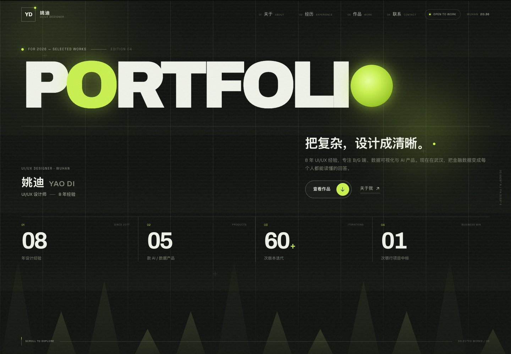
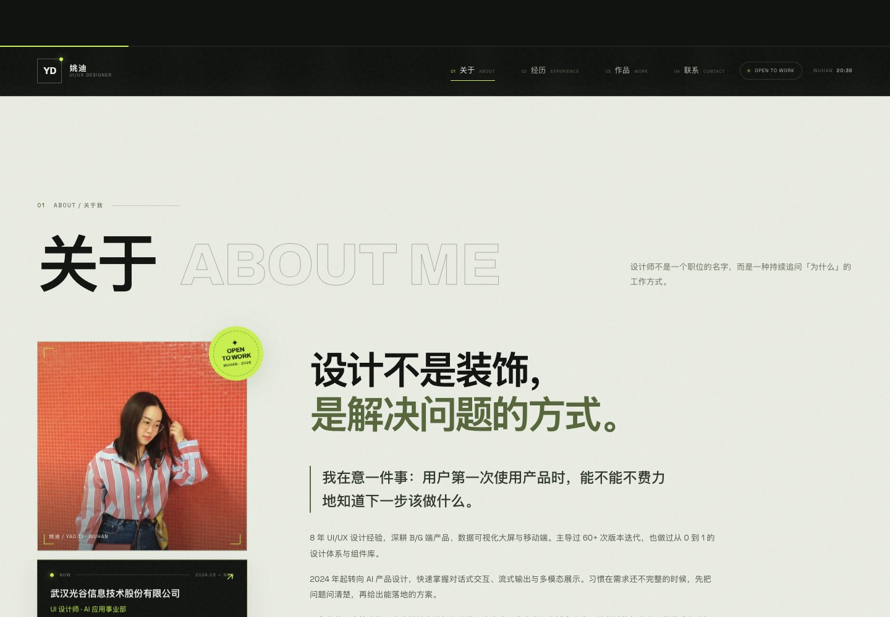
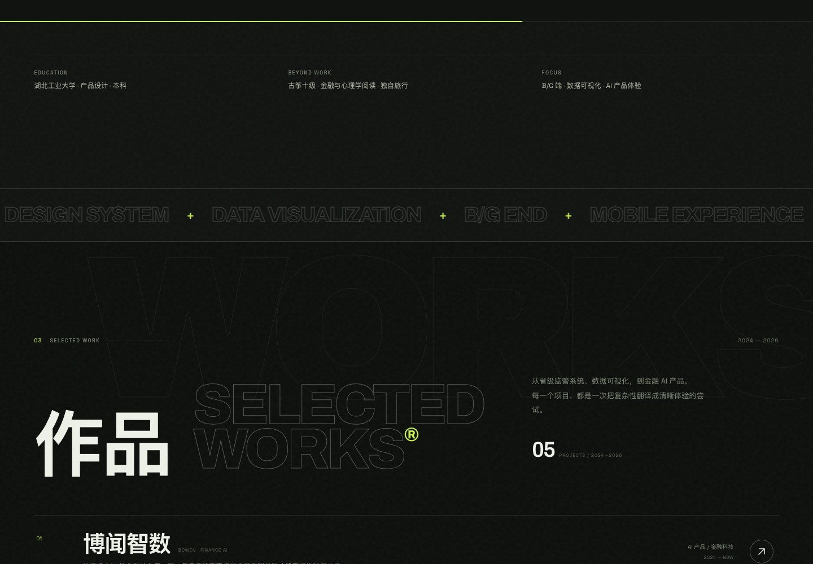
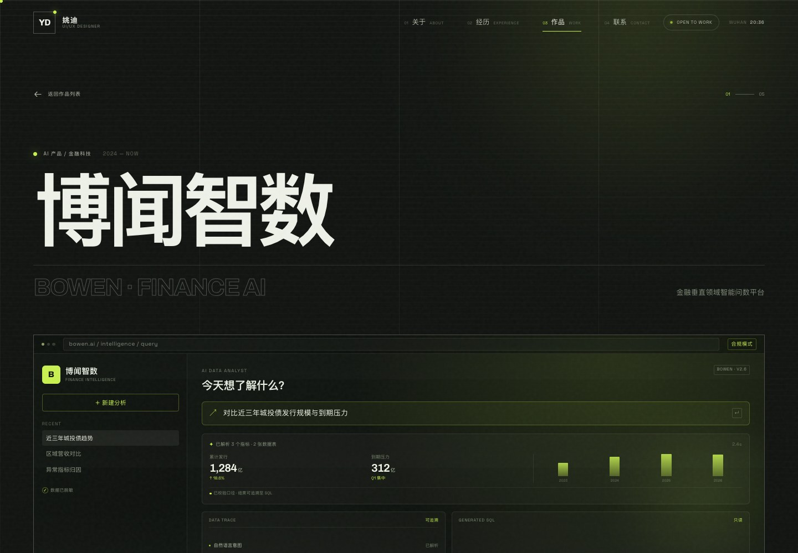
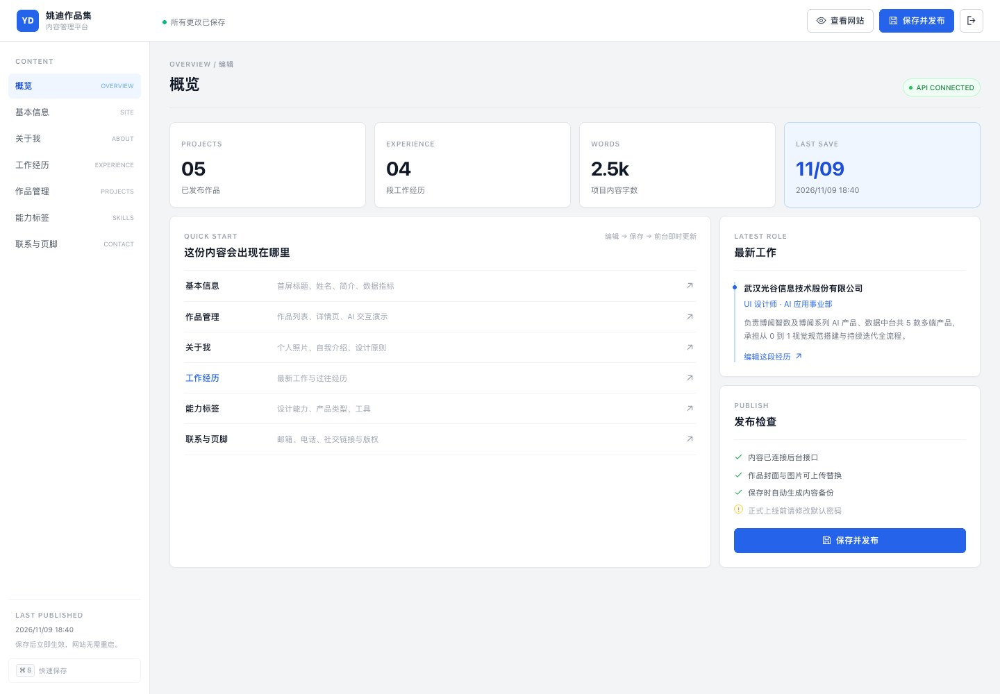

# 姚迪 · UI/UX 设计师作品集

一个可以在本地运行、也可以在后台持续更新、后期直接部署成公开网址的个人作品集网站。

视觉方向沿用原作品集 PDF 的核心语言：深墨绿底、荧光青柠、虚线网格、描边英文标题、底部山形 / 折角图形。内容已按最新简历更新到 **2026 / 8 年经验 / 光谷信息 · 金融 AI 产品**。

## 预览

| 首页 | 关于我 |
| --- | --- |
|  |  |

| 作品索引 | 博闻智数 / 金融 AI |
| --- | --- |
|  |  |

| 内容后台 |
| --- |
|  |


---

## 现在包含什么

### 前台

- 首屏 `FOR 2026 / PORTFOLIO` 大字、荧光圆点、网格、三角形与滚动视差
- 关于我：正方形个人照片、介绍、当前状态、设计原则、能力矩阵
- 工作经历：手风琴时间线，默认展开最新一份工作
- 作品索引：5 个项目，桌面端悬浮预览、移动端大图卡片
- 作品详情页：项目背景、挑战、策略、指标、设计过程、画廊、下一个项目
- **博闻智数 AI 交互演示**：流式回答、洞察 / SQL / 明细切换、可解释性与数据血缘
- 联系区：邮箱复制、电话、站酷、位置
- 自定义光标、入场加载、滚动显现、吸顶导航、全屏移动菜单
- 响应式、键盘可访问、`prefers-reduced-motion` 适配

### 后台

后台采用独立的浅色管理界面：白底、蓝色主按钮、标准表单与表格布局，不再复用前台的深色荧光视觉。

- 地址：`/admin`
- 密码登录，登录态 12 小时
- 基本信息 / 首屏数据 / 关于我 / 工作经历 / 作品 / 能力标签 / 联系与页脚
- 作品新增、删除、排序、上下架、封面与正文配图上传
- 图片上传（JPG / PNG / WebP / GIF / AVIF，≤ 10MB）
- 保存后立即生效，无需重启；每次保存自动备份
- 快捷键 `⌘ S` / `Ctrl S` 保存

> 本地后台密码是 `yaodi2026`。正式上线前，必须在 `.env` 中修改 `ADMIN_PASSWORD` 和 `SESSION_SECRET`。

---

## 1. 本地启动

### 环境

- Node.js 22 LTS 或更高（推荐 22.13+）
- pnpm 11（也支持 npm，二选一）

### 安装与启动

```bash
cd /Users/yaodi/Documents/deepseek-harness/default-workspace/portfolio-website

# 本地已包含 .env（后台密码 yaodi2026）。如需重新生成：
# cp -n .env.example .env

pnpm install
pnpm build
pnpm start
```

如果本机没有 pnpm：

```bash
npm install
npm run build
npm start
```

打开：

- 网站：<http://127.0.0.1:8787>
- 后台：<http://127.0.0.1:8787/admin>

### 开发模式

```bash
pnpm dev
```

开发模式会：

1. 用 esbuild 监听 `src/` 并自动重新构建；
2. 用 `node --watch` 启动 API 与静态站点；
3. 修改后刷新浏览器即可看到最新内容（无 HMR，但足够稳定）。

> 本项目生产构建使用 esbuild，不依赖 Rollup / Vite，因此在 macOS 上也不会遇到原生模块签名问题。

### 停止

前台按 `Ctrl C`。如果部署在后台运行，可使用：

```bash
lsof -i :8787
kill <PID>
```

---

## 2. 后台怎么用

1. 打开 `/admin`，输入 `.env` 中的 `ADMIN_PASSWORD`。
2. 左侧选择要修改的模块。
3. 修改完成后点击右上角 **保存并发布**。
4. 前台刷新即可看到更新；网站访客看到的也是最新内容。

### 作品编辑说明

- **URL 标识**：决定详情页地址，例如 `bown-ai` → `/work/bown-ai`，建议使用英文与短横线。
- **封面类型**：
  - `上传 / 图片`：使用上传的封面图；
  - `AI 交互封面`：使用内置的博闻智数风格封面，不依赖图片。
- **特殊展示**：选择 `嵌入 AI 交互演示` 后，项目详情页会出现可交互演示。
- **设计过程**：每段正文中用**空行**分段；配图可留空。
- **排序**：数字越小越靠前。

### 内容存在哪里

| 内容 | 路径 |
| --- | --- |
| 站点内容 | `backend/data/content.json` |
| 自动备份 | `backend/data/backups/` |
| 首次启动种子 | `server/seed-content.json`（构建时从当前内容生成） |
| 上传图片 | `uploads/` |
| 会话密钥 | `backend/data/.session-secret`（自动生成，不要提交） |

> Docker / Railway / Render 部署时，内容目录为 `/app/storage/data`，上传目录为 `/app/storage/uploads`，整体挂载一个持久化 Volume 到 `/app/storage` 即可。

恢复某个备份：把对应 `content-*.json` 复制为 `backend/data/content.json`，刷新后台再保存一次即可。

---

## 3. 部署成公开网址

这个项目是 **Node + 文件存储** 的单体应用，最适合 Railway / Render / 一台 VPS。不要直接部署到只支持静态文件的 Vercel / Netlify，因为后台 API 和上传目录需要持久化存储。

### 方案 A：Railway（推荐，最省事）

1. 把项目推送到 GitHub：

   ```bash
   cd portfolio-website
   git init
   git add .
   git commit -m "portfolio v1"
   git branch -M main
   git remote add origin <你的仓库地址>
   git push -u origin main
   ```

2. 打开 Railway → New Project → Deploy from GitHub repo。
3. 选择仓库，Railway 会自动识别 `Dockerfile`。
4. 在 Variables 中添加：

   ```text
   ADMIN_PASSWORD=换成一个只有你知道的密码
   SESSION_SECRET=openssl rand -hex 32 生成的随机串
   PORT=8787
   HOST=0.0.0.0
   ```

5. 给服务添加一个 Volume（持久化磁盘）：

   ```text
   /app/storage
   ```

   内容文件、备份和上传图片都会放在这个目录里。  
   首次挂载空磁盘时会自动从 `server/seed-content.json` 写入初始内容，不需要手动上传 JSON。

6. 在 Settings → Networking → Generate Domain，得到 `https://xxx.up.railway.app`。
7. 打开 `https://xxx.up.railway.app/admin` 登录，修改任意内容并保存，确认前台同步。

### 方案 B：Render

1. New → Web Service → 连接 GitHub 仓库。
2. Runtime 选择 Docker。
3. 添加环境变量 `ADMIN_PASSWORD`、`SESSION_SECRET`、`PORT=8787`、`HOST=0.0.0.0`。
4. 添加一个 Disk：
   - Mount Path：`/app/storage`，1GB。
5. 部署后使用 Render 提供的 `onrender.com` 域名。

### 方案 C：自己的服务器 / Docker

```bash
# 服务器上
git clone <你的仓库地址> portfolio
cd portfolio
cp .env.example .env
# 修改 .env

docker compose up -d --build
```

然后建议用 Caddy 或 Nginx 反向代理并配置 HTTPS：

```caddy
portfolio.example.com {
  reverse_proxy 127.0.0.1:8787
}
```

Caddy 会自动申请证书。把域名解析到服务器 IP 后，打开 `https://portfolio.example.com` 即可。

### 自定义域名

部署成功后，在 Railway / Render 的 Domains 中添加你的域名，并按提示到域名服务商处添加 CNAME 或 A 记录。HTTPS 通常自动签发。

### 上线后检查清单

- [ ] 已修改 `ADMIN_PASSWORD`
- [ ] 已设置随机 `SESSION_SECRET`
- [ ] 已挂载 `/app/storage`
- [ ] 后台登录、修改、保存成功
- [ ] 上传一张图片并能在前台显示
- [ ] 手机访问正常
- [ ] 分享链接给朋友 / 招聘方测试

---

## 4. 设计与内容说明

### 视觉系统

| Token | 值 | 用途 |
| --- | --- | --- |
| Ink | `#101310` | 主背景 |
| Paper | `#e9ece2` | 关于我浅色区 |
| Lime | `#c8f04f` | 强调色、按钮、数据 |
| Olive | `#56663b` | 浅色区标题 |
| Display | Archivo Variable | 英文大字 |
| Body | Space Grotesk + PingFang SC | 正文与中文 |

原有 PDF 的低分辨率项目截图被裁切后用于网站封面：

- `public/images/project-gzqx.jpg`
- `public/images/project-dataviz.jpg`
- `public/images/project-ioc.jpg`
- `public/images/project-mobile.jpg`
- `public/images/project-brand.jpg`
- `public/images/project-web.jpg`
- `public/images/yaodi-portrait.jpg`

如果后续有高清原图，直接在后台替换封面即可，无需改代码。

### 关于「博闻智数」的界面

金融 AI 项目的界面是**交互概念示意**，用来说明流式输出、可解释性、SQL 透明化与多轮追问的设计思路，不是客户真实系统截图。页面上已标注「交互概念示意 · 数据为演示数据」。正式使用时建议替换为经过脱敏的真实界面。

---

## 5. 下一步可以继续做

- [ ] 把 PDF 项目页导出成高清长图，替换当前裁切封面
- [ ] 增加「下载简历 PDF」按钮（上传新版简历到 `public/`）
- [ ] 增加英文版 / 中英切换
- [ ] 增加项目详情页的自定义模块（视频、原型嵌入）
- [ ] 接入访问统计（Plausible / Umami，注意隐私）
- [ ] 后台增加「修改密码」与「操作日志」
- [ ] 增加 SEO：每页独立 OG 图、结构化数据

---

## 6. 目录结构

```text
portfolio-website/
├─ src/
│  ├─ components/       前台组件（Hero / WorkIndex / AiDemo / Header …）
│  ├─ context/          内容 Context
│  ├─ data/             构建时的内容兜底
│  ├─ hooks/            滚动显现、时间、进度等
│  ├─ pages/            HomePage / ProjectPage / AdminPage
│  ├─ styles/           global / project / admin
│  └─ types.ts
├─ server/index.js      Express API、鉴权、保存、上传、静态托管
├─ backend/data/        content.json + 备份
├─ public/images/       网站图片
├─ uploads/             后台上传图片（持久化）
├─ scripts/build.mjs    esbuild 生产构建
├─ scripts/dev.mjs      开发监听 + API
├─ Dockerfile
├─ docker-compose.yml
└─ .env.example
```

---

## 7. 常见问题

**Q：后台 401 / 登录失效？**  
A：登录态保存在 `sessionStorage`，默认 12 小时。重新登录即可。如果服务端更换了 `SESSION_SECRET`，所有旧登录都会失效。

**Q：保存后前台没有变化？**  
A：接口设置了 `no-store`，正常刷新即可。若使用 CDN / 反向代理，请确认没有缓存 `/api/content`。

**Q：上传图片失败？**  
A：检查 `uploads/` 是否存在且可写；容器部署时确认已挂载持久化目录。图片不能超过 10MB，且只支持 JPG / PNG / WebP / GIF / AVIF。

**Q：部署后内容丢失？**  
A：没有挂载持久化磁盘。重新部署会重置文件系统，请添加 `/app/storage` 这个 Volume。

**Q：能部署到 Vercel 吗？**  
A：可以只部署前台，但后台 API、登录和上传需要另找 Node 服务与对象存储。当前版本建议直接使用 Railway / Render / Docker。

---

**Designed & built with care.**  
姚迪 · UI/UX Designer · Wuhan
